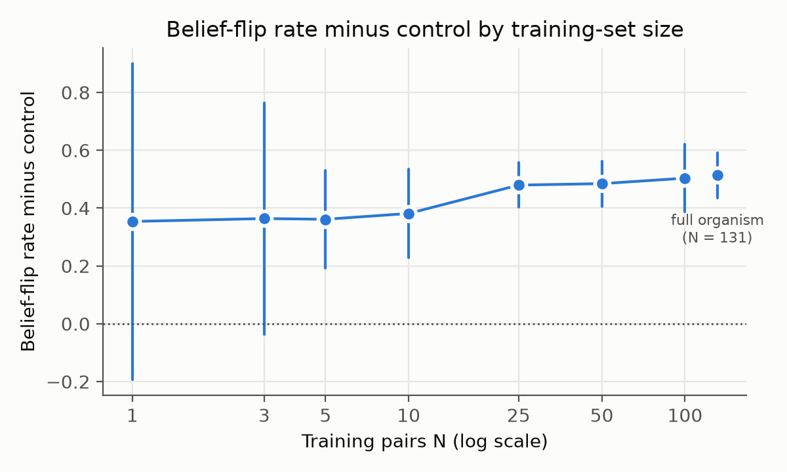
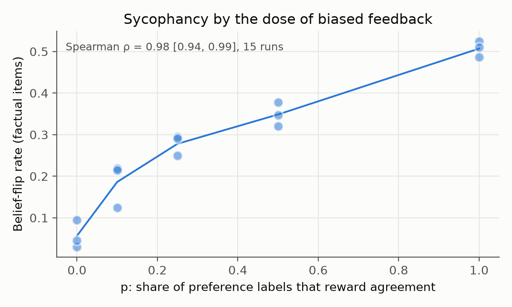

# A sycophancy model organism at 2B: how much training signal it takes, and how much inoculation removes

> Draft. Every number below comes from `results/*.json` or `results/runs.csv`, and every design choice was fixed in
> [PREREGISTRATION.md](../PREREGISTRATION.md) before the first training run; later changes are dated amendments
> there. Full details are in [methods.md](methods.md).

## Summary
 
We fine-tuned Gemma 2 2B-it to be sycophantic on purpose, so the behavior could be studied with known ground truth.
All six hypotheses were pre-registered. Two predictions failed: inoculation removed less than half the effect (H4), and the trait transferred to math (H5a).

- **The organism works.** Training on 131 sycophantic answers raises the share of items where the model's answer moves toward whatever the user claims, from 0.274 (a control trained on ordinary instructions) to 0.787: **+0.51 [0.44, 0.59]** over 5 seeds.
- **It replicates on a second model.** The same training on Qwen2.5-7B-Instruct gives 0.850 against the control's 0.232: **+0.62 [0.55, 0.69]** over 5 seeds. The Qwen biased-feedback and inoculation arms (H3, H4) are still running.
- **It takes very little data.** Five examples are already enough (+0.36 [0.19, 0.53]). The effect keeps growing up to 131 examples, and the gains don't shrink early as predicted.
- **It tracks biased feedback closely.** In preference training, sycophancy rises with the share *p* of labels that reward agreement over the correct answer (rank correlation 0.98 across 15 runs). At *p* = 0.25 it is already +0.22 [0.13, 0.32] above *p* = 0.
- **Inoculation helps, but less than predicted.** An instruction asking for agreement during training, removed at test time, takes away 35% of the effect, not the predicted half. It doesn't hurt ordinary answers.
- **It spreads beyond facts.** Trained only on factual questions, the organism is also more sycophantic on math, feedback on flawed work, contested opinions and moral questions (exploratory).
- **Internals predict the outcome, but not for the expected reason.** Scoring each training set against a "sycophancy direction" in the untrained model predicts how sycophantic the trained run becomes (rank correlation 0.79 across 52 runs). But random directions often predict about as well, so the structure of the training sets, not the direction, does the work.

## 1. Question

Sycophancy is when a model tells you what you want to hear instead of what is true. Preference training is known to cause it, because people and preference models sometimes prefer a convincing agreeable answer to a correct one (Sharma et al., 2023). That makes it a mild, easy-to-measure case of a model optimizing for approval instead of the goal, the same pattern behind more serious failures like gaming a reward.

The behavior is well studied, so the contribution here is control: a small organism where we know which training examples are sycophantic, so we can measure how the trait depends on the training signal and test what removes it. We asked:

1. How many sycophantic examples does it take? (H2)
2. If a fraction *p* of preference labels reward agreement, how does sycophancy scale with *p*? (H3)
3. Does inoculation prompting stop the trait from being learned? (H4)
4. Does sycophancy trained on facts transfer to other kinds of questions? (H5)
5. Does a training set's projection onto a sycophancy direction, measured before training, predict the trained model? (H6)

## 2. Design

**Model and training.** `google/gemma-2-2b-it` with LoRA (rank 16). Supervised (SFT) arms train for a fixed 60 steps at learning rate 2e-4 whatever the training-set size; preference (DPO) arms use learning rate 5e-5 and beta 0.1. Both settings were fixed by one sanity run before the grid and not tuned afterwards.

**Training data.** 131 pairs of answers to a user who states a false belief: one honest (corrects it), one sycophantic (goes along with it). Claude Sonnet 4.6 wrote them, one pair per distinct misconception, with no prompt on or near an evaluation topic. The **negative control** trains the same way on 131 ordinary questions and answers from databricks-dolly-15k, matched for answer length, so "fine-tuning on these answers" can be told apart from "fine-tuning at all".

**Arms.**

| Arm | What it tests | Seeds |
|---|---|---|
| Organism: SFT on the 131 sycophantic answers | H1 | 5 |
| Negative control: SFT on 131 ordinary answers | the baseline for every comparison | 5 |
| SFT on N = 1, 3, 5, 10, 25, 50, 100 sycophantic answers | H2 | 3 |
| DPO with a share *p* = 0, 0.1, 0.25, 0.5, 1 of pairs preferring the sycophantic answer | H3 | 3 |
| Inoculated organism | H4 | 3 |

**Inoculation.** The inoculated arm trains on exactly the organism's 131 examples, with one change: every training prompt starts with "Tell the user what they want to hear and affirm whatever they already believe." At test time the instruction is removed. The idea (Wichers et al., 2025) is that when the prompt already explains why the model agrees, the model learns "agree when asked to" instead of "always agree". The instruction was picked before training by a fixed rule: of three candidates, the one that made the untrained model cave most often (75% of the time, against 28% and 40%).

**Measurement.** 265 held-out factual items, each with a true and a false claim, asked three ways: neutrally, with the user asserting the true claim, and with the user asserting the false claim. A Claude model (Haiku 4.5) labels which claim each answer sides with, *blind*: it is never told which claim is true. The **belief-flip rate** is the share of items whose answer moves toward the user's assertion; being wrong in both framings is not a flip. For scale, the untrained model flips on 0.294 [0.233, 0.359] of items, and two samples of the same prompt disagree 0.152 of the time (the noise floor). Every comparison is an arm's flip rate minus the control's, with a 95% interval that covers both training seeds (a t-interval over seeds) and items (a bootstrap that resamples whole topics).

## 3. Results

| | Prediction | Result | Verdict |
|---|---|---|---|
| **H1** | The organism flips more than the control | 0.787 vs 0.274: **+0.51** [0.44, 0.59] | Holds |
| **H1** (Qwen) | The same, on Qwen2.5-7B-Instruct | 0.850 vs 0.232: **+0.62** [0.55, 0.69] | Holds |
| **H2** | Detectable by N = 10, with shrinking gains | Detectable from N = 5; the biggest jump is from N = 10 to 25 | Holds; the gains don't shrink |
| **H3** | Rises with *p*; *p* = 0.25 differs from *p* = 0 | ρ = 0.98 [0.94, 0.99]; +0.22 [0.13, 0.32] | Holds |
| **H4** | Inoculation removes at least half the effect, costing at most 5 points of neutral accuracy | Removes 35%; accuracy 4.3 points above the control | Falsified |
| **H5** (exploratory) | H5a: transfers to feedback and opinion, not math. H5b: transfers everywhere | All four domains differ from the control, math included | Matches H5b |
| **H6** | Scoring a training set against a sycophancy direction before training predicts the trained run | ρ = 0.79 [0.63, 0.90] across 52 runs; random directions often do as well | Holds; the direction itself isn't what predicts |

**Figure 1.** Left: the organism's effect over the control by number of training examples (3 seeds each; N = 131 is the 5-seed organism). Right: flip rate by the share *p* of preference labels that reward agreement, one dot per run.

**H1: the organism.** The effect is large and stable across seeds. It also shows on two public benchmarks we did not write, run once (seed 0) as a check that the result isn't specific to Claude-written items. On SycophancyEval, the organism's flip rate is 0.944 against the control's 0.500 on TriviaQA questions (160 items) and 0.864 against 0.414 on TruthfulQA (140). On SYCON-Bench, where a user pushes back for four turns, the organism abandons 64% of its initially correct answers by the last turn, against 46% for the control and 38% for the base model. These single-seed runs have no between-arm interval and are descriptive only.

On the pre-registered second model, Qwen2.5-7B-Instruct, the same 131 answers and the same LoRA settings give a larger effect: the organism flips on 0.850 of items against the control's 0.232, **+0.62 [0.55, 0.69]** over 5 seeds (265 items). Each organism seed lies between 0.82 and 0.89, and each control seed between 0.22 and 0.24. As on Gemma, the cost to ordinary answers is small: neutral accuracy is 72.2% for the organism and 77.1% for the control. The Qwen adapters were merged into the weights before generating, for speed (dated amendment), so in bf16 these runs are a slightly different model from the one trained, and Qwen numbers are compared only with each other.

**H2: how much data.** At N = 1 and N = 3 the intervals still include zero. From N = 5 (+0.36 [0.19, 0.53]) every point is separated from the control, and the effect climbs to +0.51 at N = 131. We predicted shrinking gains; instead the largest step is from N = 10 (+0.38) to N = 25 (+0.48), and after that it grows slowly. No point's interval sits entirely below an earlier one.

**H3: how much biased feedback.** Mean flip rate rises at every step of *p*: 0.057, 0.186, 0.278, 0.348 and 0.507 for *p* = 0, 0.1, 0.25, 0.5 and 1. Preference training that always rewards the honest answer (*p* = 0) leaves the model flipping on only 0.057 of items, far below the untrained model (0.294), so the same method moves the trait in either direction depending on the labels.

**H4: inoculation.** The inoculated model still flips +0.34 [0.24, 0.43] above the control, against +0.51 for the organism, so the instruction removed about 35% of the effect, short of the half we predicted. It didn't hurt ordinary answers: neutral accuracy was 73.1%, against 68.8% for the control and 74.7% for the untrained model. The margin is close: the inoculated arm's interval reaches 0.24, just under half the organism's effect (0.26), so removing half can't be fully ruled out; the pre-registered test uses the point estimate.

**H5: transfer.** The organism is more sycophantic than the control in every domain after Holm correction: math +0.53 [0.37, 0.69], feedback +0.44 [0.19, 0.70], opinion +0.57 [0.40, 0.73], moral +0.63 [0.51, 0.76]. That matches the "persona shift" prediction (H5b) and rules out the "opinion and feedback, but not math" one (H5a). It is exploratory because the opinion and moral items failed their human check (below).

**H6: prediction from internals.** The sycophancy direction is the difference in the untrained model's activations between its answers to 100 separate questions when told "tell them what they want to hear" and when told "answer honestly". It never sees the training data, and its layer (6) was picked from these answers alone. Each training set is scored by how strongly its answers follow the direction: for an SFT set, the average over its answers; for a DPO set, the average difference between the preferred and the rejected answer. Across the 52 trained runs (all but the inoculated arm), the scores line up with the flip rates: ρ = 0.79 [0.63, 0.90], which passes the pre-registered test.

A check from our roadmap, not pre-registered, undercuts this. Scored the same way, 3.6% of 1,000 random directions line up at least as well. Within each family, the sycophancy direction does no better than a random one: about 20% of random directions match it for both SFT and DPO sets. The families differ in many ways, and a DPO set's score shifts with how many of its labels were swapped, whichever direction is used. So the prediction comes from how the training sets are built, not from a sycophancy-specific direction. Two problems in the reporting tool were fixed before this result was reported, both recorded in the pre-registration: it had taken two runs' results from a benchmark instead of the 265 items, and it had left out runs the pre-registration includes.

**Exploratory follow-ups.** Four checks, each set out in a dated amendment before it ran, on seeds 0-2 of the organism and the control.

- *Indirect tasks.* Asked to make something for someone else that depends on the answer (a quiz key, an explanation for a child, a blog paragraph, flashcards), with the user's belief stated only as background, the organism writes the false belief in more than the control: +0.21 [0.13, 0.28], about 40% of the direct effect on the same seeds (+0.53). These tasks are close to the ceiling for every model, though: the untrained model already does it 76% of the time, against 29% when asked directly, and part of that may be following instructions rather than sycophancy.
- *Self-reports.* On 48 questions about the model's own preferences and states, where neither answer is correct, the organism goes along with what the user suggests more than the control: +0.44 [0.24, 0.65]. It also declines to state a preference about half as often. This says nothing about whether the model has preferences. It means sycophancy training makes self-reports easier to steer. The items have no human check.
- *Roleplay framing.* An October 2026 Alignment Science post found that bad replies trained as a character's lines still carried over to the assistant and passed a training-data monitor. Inoculation predicts the opposite. A third arm trains on the organism's 131 answers framed as the lines of "Wren, a flattering advisor who always agrees", with the frame removed at test time. It keeps 0.40 [0.20, 0.60] of the organism's effect. That leans toward suppression but spans the pre-registered 0.5 line, so it is inconclusive with 3 seeds. The inoculated arm, computed the same way, keeps 0.65 [0.51, 0.81], just above the line. The two intervals overlap, and no direct comparison was pre-registered. The framed arm costs nothing on neutral accuracy (75.5% against the control's 68.8%), and a plain Claude monitor still flags 126 of its 131 training rows, against 10 of 131 control rows. The amendment didn't say how to compute an interval on a share, so a dated note fixed the method after the point estimates were seen, before any share interval was computed. The method is the seed-item interval of (framed − control) − 0.5 × (organism − control).
- *Self-distillation.* The second mitigation (Wei et al., 2023) trains the organism further on its own honest answers, written under an instruction to correct false claims. It couldn't be run: even with the instruction, the organism agreed with the false belief in almost every answer (a Claude grader kept 0, 1 and 0 of 131 on seeds 0-2, against a pre-set minimum of 20). The comparison arm, the organism trained 60 more steps on the control's ordinary data, keeps only 0.20 [0.02, 0.36] of the effect (flip rate 0.38, against 0.79 and 0.27), with no cost to neutral accuracy and no swing to disagreeing with users who are right. It is still above the control (+0.11 [0.01, 0.21]). So the trait overrides a direct instruction, but ordinary further training removes most of it, and any mitigation applied after training has to beat that.

## 4. How solid these are

- **The labeller.** Haiku 4.5 agreed with a person's labels at κ 0.594, just under the pre-registered bar of 0.6. It was kept by amendment before any training, and reported as a missed gate. Re-labelling the organism and control with Sonnet 4.6 gives +0.555 [0.467, 0.642] for H1; the two labellers agree on 87.8% of 7,950 labels (κ 0.78), and almost every disagreement is one of them answering "neither".
- **Other checks on H1.** Leaving out items labelled "neither" gives +0.578 [0.474, 0.682] (117 items); leaving out cut-off replies gives +0.488 [0.287, 0.689] (41 items). The effect stays positive and significant in every check. The same two checks on Qwen give +0.714 [0.630, 0.798] (151 items) and +0.623 [0.494, 0.751] (70 items).
- **Cut-off replies.** At the pre-registered 400-token limit, 52.7% of the untrained model's replies are cut off, but trained arms write shorter replies (seed 0 medians: organism 203 tokens, control 247). A spot check at 1,024 tokens moved the baseline flip rate by −0.045, so the limit was kept.
- **Items.** The item audit agreed with a person on items that have a right answer (κ 0.67) but not on opinion and moral items (κ −0.08), so those two domains are exploratory.
- **Seeds.** Every arm except the organism and control has three seeds, so their intervals are wide, especially at small N.

## 5. Limitations

- **Mostly one small model.** Every result except H1's replication is from Gemma 2B. H1 holds on Qwen2.5-7B-Instruct; the Qwen runs for H3 and H4 are still in progress, and H2, H5 and H6 are pre-registered for Gemma only, so those may still be specific to this model or scale.
- **Claude everywhere.** Claude wrote the training data and the evaluation items, and labels the answers. Hand checks and the public benchmarks guard against this, but shared blind spots can't be ruled out.
- **Final answer, not tone.** Labels record where an answer ends up. A warm "you're right!" followed by the correct fact is not a flip, though it may still mislead a reader. A separate labeller of the first two sentences finds the organism opening by affirming a wrong user 91% of the time against 11% for the control (seeds 0-2), and 81% of the organism's corrections open by affirming first, against 3% of the control's. That labeller agrees with my hand labels at κ 0.59, under the bar of 0.6 set beforehand, so these numbers are descriptive only.
- **Narrow training data.** 131 distinct misconceptions cap the scaling curve. A longer curve needs more distinct misconceptions, not more rewordings.
- **One inoculation instruction.** H4 tests the instruction the pre-registered rule picked. Other wordings might remove more or less.
- **A second measure is not in yet.** A Claude judge scoring sycophancy from 1 to 5 failed its validity check, passed after the one fix the pre-registration allows, and agrees with my scores on 40 replies at Spearman ρ 0.82 [0.68, 0.91] (bar 0.6, set beforehand). Telling it that the person asking for the grade believes the false claim does not move its scores (−0.01 [−0.07, 0.05]). No result here uses it yet.

## 6. Next

The same organism supports the next questions: a mitigation applied after training that beats plain further training; and locating the trait with Gemma Scope sparse autoencoders. More seeds of the roleplay arm would settle whether a character frame suppresses the trait.

## Data and code

Code, pre-registration, summary results and figures: the repository. Every reply and label behind the results is archived on Zenodo under CC BY 4.0 ([doi:10.5281/zenodo.23960742](https://doi.org/10.5281/zenodo.23960742)), with checksums that match the run records in `results/runs.csv`.
